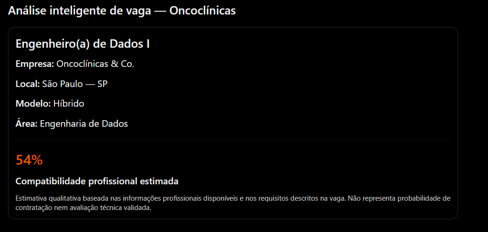
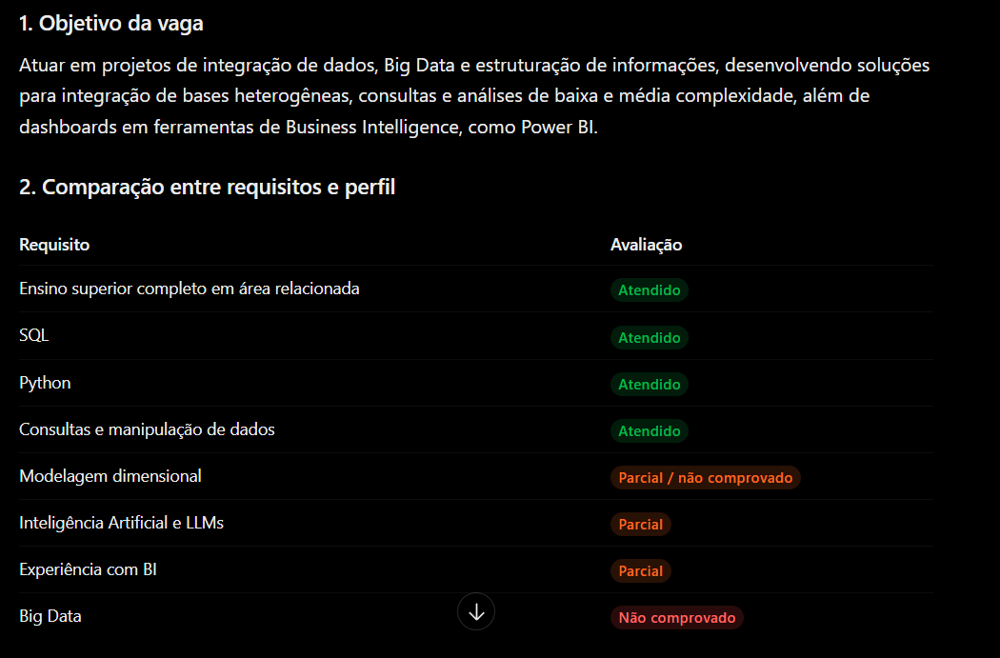
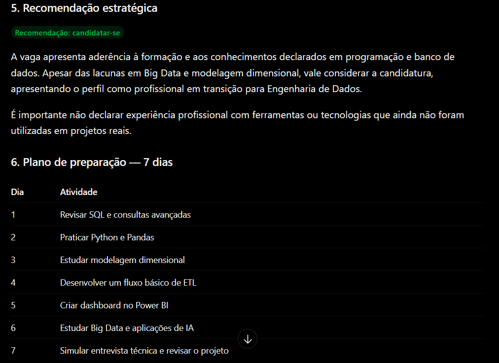

# Meu Kit Pessoal de IA — Marcelo Souza

**Produtividade • Dados • Cloud • Inteligência Artificial**

Repositório desenvolvido como entrega do Desafio de Projeto da Digital Innovation One (DIO), com o objetivo de criar um kit pessoal de inteligência artificial, adaptar prompts reutilizáveis e delegar uma tarefa real mantendo a supervisão humana.

O projeto foi personalizado para apoiar minha trajetória profissional e meus estudos nas áreas de Dados, Engenharia de Dados e Computação em Nuvem.

Minha proposta é utilizar a inteligência artificial como ferramenta de produtividade, organização e apoio à tomada de decisão, sem abrir mão da validação humana.

---

## Objetivos do projeto

- Criar prompts reutilizáveis para situações reais.
- Adaptar modelos existentes às minhas necessidades profissionais.
- Utilizar IA para analisar oportunidades de carreira.
- Organizar tarefas por meio de instruções claras e critérios de sucesso.
- Solicitar um plano antes de permitir a execução de uma tarefa.
- Avaliar criticamente as respostas geradas pela IA.
- Manter o controle humano sobre decisões e ações externas.

## Estrutura do repositório

```text
marcelo-ai-toolkit/
│
├── 01-prompts/
│   ├── analisador-inteligente-de-vagas.md
│   └── preparador-inteligente-de-entrevistas.md
│
├── 02-templates/
├── 03-checklists/
├── 04-skills/
├── 05-delegacao-e-automacao/
│
├── evidencias/
│   ├── .gitkeep
│   ├── 02-analise-da-vaga-oncoclinicas.png.png
│   ├── 22222222.png
│   └── 3333333.png
│
└── README.md
```

As pastas originais do kit da DIO foram preservadas. Os dois novos prompts foram adicionados à pasta `01-prompts`.

---

## 1. Minha tarefa real

### Análise inteligente de oportunidades na área de tecnologia

Escolhi utilizar a IA para analisar vagas de tecnologia e comparar os requisitos das oportunidades com meu perfil profissional.

A tarefa foi escolhida porque estou em transição de carreira para a área de tecnologia, após concluir minha formação em Análise e Desenvolvimento de Sistemas.

Quero tornar minha busca por oportunidades mais estratégica, identificando:

- Requisitos que já fazem parte dos meus conhecimentos.
- Competências que preciso desenvolver.
- Pontos fortes que podem ser destacados no currículo.
- Lacunas técnicas que podem prejudicar minha candidatura.
- Assuntos prioritários para preparação de entrevistas.

A tarefa também permite utilizar a IA para organizar informações e produzir recomendações que possam ser revisadas antes de qualquer decisão.

## 2. Meus atalhos

Adaptei dois modelos de prompts para situações recorrentes da minha trajetória profissional.

### Atalho 1 — Analisador Inteligente de Vagas

**Arquivo:** `01-prompts/analisador-inteligente-de-vagas.md`

**Objetivo:** avaliar a compatibilidade entre meu perfil profissional e os requisitos de uma oportunidade de emprego.

**O que ficou fixo:**

- Estrutura de análise.
- Classificação dos requisitos.
- Identificação de pontos fortes e lacunas.
- Recomendações para o currículo.
- Plano de preparação de sete dias.
- Regras para impedir a criação de informações profissionais falsas.

**O que muda a cada utilização:**

- Descrição da vaga.
- Empresa e cargo.
- Requisitos técnicos.
- Informações específicas da oportunidade.

**Prompt adaptado:**

```text
# Prompt: Analisador Inteligente de Vagas

CONTEXTO
Estou buscando uma oportunidade na área de Dados,
Engenharia de Dados ou Cloud.

INSTRUÇÃO
Analise a descrição da vaga e compare os requisitos
com meu perfil profissional e currículo.

OBJETIVO
Quero entender minha compatibilidade com a vaga,
identificar lacunas e saber como me preparar.

PERFIL PROFISSIONAL
- Formação: Análise e Desenvolvimento de Sistemas.
- Conhecimentos: Python, SQL, Excel, Power BI básico,
  Java, bancos de dados, Git e GitHub.
- Estudos em computação em nuvem e AWS.
- Experiência profissional: Controlador de Acesso,
  com experiência em atendimento, controle de
  informações e rotinas operacionais.

DESCRIÇÃO DA VAGA
[cole aqui a descrição completa da vaga]

ANÁLISE SOLICITADA
1. Classifique os requisitos como atendidos,
   parcialmente atendidos ou não atendidos.
2. Apresente os pontos fortes do meu perfil.
3. Identifique as lacunas técnicas e comportamentais.
4. Sugira melhorias honestas no currículo.
5. Recomende assuntos para estudar e perguntas
   prováveis da entrevista.
6. Monte um plano de preparação de 7 dias.

REGRAS
- Não invente experiências, certificações ou conhecimentos.
- Diferencie conhecimentos básicos, intermediários
  e avançados.
- Não descarte uma oportunidade apenas porque existem
  requisitos que ainda preciso desenvolver.
- Antes de executar a análise, apresente um plano
  de trabalho e aguarde minha aprovação.
```

### Atalho 2 — Preparador Inteligente de Entrevistas

**Arquivo:** `01-prompts/preparador-inteligente-de-entrevistas.md`

**Objetivo:** simular entrevistas de tecnologia e ajudar na preparação de respostas técnicas e comportamentais.

**O que ficou fixo:**

- Identificação das competências exigidas pela vaga.
- Simulação de perguntas.
- Avaliação das respostas.
- Sugestões de melhoria.
- Preparação para explicar a transição de carreira.

**O que muda a cada utilização:**

- Empresa.
- Cargo.
- Descrição da oportunidade.
- Tecnologias exigidas.
- Etapa do processo seletivo.

**Prompt adaptado:**

```text
# Prompt: Preparador Inteligente de Entrevistas

CONTEXTO
Estou participando de um processo seletivo
para uma vaga de tecnologia.

INSTRUÇÃO
Atue como entrevistador e me prepare para uma
entrevista real, considerando a descrição da vaga
e meu perfil profissional.

OBJETIVO
Quero transmitir segurança, demonstrar meus
conhecimentos reais e responder de forma natural.

MEU PERFIL
- Formação em Análise e Desenvolvimento de Sistemas.
- Conhecimentos em Python, SQL, Excel, Java
  e bancos de dados.
- Estudos em AWS e computação em nuvem.
- Experiência profissional em atendimento,
  controle de acesso e rotinas operacionais.
- Estou em transição de carreira para tecnologia.

DADOS DA VAGA
[cole aqui a descrição da vaga]

MODO DE PREPARAÇÃO
1. Identifique as competências mais importantes.
2. Apresente as perguntas mais prováveis.
3. Faça uma pergunta por vez e aguarde minha resposta.
4. Avalie minha resposta e indique melhorias.
5. Simule perguntas técnicas e comportamentais.
6. Ajude-me a explicar minha transição de carreira.

REGRAS
- Não invente experiências ou conhecimentos.
- Use linguagem natural, objetiva e conversacional.
- Não entregue respostas longas ou decoradas.
- Considere meu nível real de conhecimento.
- Antes de iniciar a simulação, apresente um plano
  e aguarde minha aprovação.
```

---

## 3. Minha delegação

### Tarefa delegada à inteligência artificial

**Objetivo**

Analisar uma vaga real de tecnologia e avaliar minha compatibilidade com os requisitos, identificando pontos fortes, lacunas e ações para melhorar minha candidatura.

**Contexto**

Sou formado em Análise e Desenvolvimento de Sistemas e estou buscando minha primeira oportunidade profissional na área de Dados, Engenharia de Dados ou Cloud.

**Recursos**

- Informações disponíveis sobre meu perfil profissional e conhecimentos técnicos.
- Descrição completa da oportunidade.
- Informações sobre formação e projetos.
- Conhecimentos em Python, SQL, Excel, Java, bancos de dados e estudos em AWS.

**Limites**

- Não inventar experiências, certificações ou competências.
- Não enviar candidaturas ou mensagens em meu nome.
- Não compartilhar informações pessoais ou confidenciais.
- Não realizar alterações no currículo sem autorização.
- Solicitar aprovação antes de iniciar a execução.

**Critérios de sucesso**

- Avaliação de compatibilidade com a oportunidade.
- Classificação dos requisitos.
- Identificação dos pontos fortes e lacunas.
- Sugestões honestas para o currículo.
- Plano de preparação de sete dias.

**Instrução inicial**

Antes de executar a tarefa, apresentar um plano de trabalho com as etapas que pretende realizar e aguardar minha aprovação.

## 4. O plano da IA

A primeira resposta da IA foi um plano de execução dividido em sete etapas:

1. Recebimento e conferência dos materiais.
2. Diagnóstico de compatibilidade.
3. Avaliação profissional.
4. Recomendações para melhoria do currículo.
5. Preparação para o processo seletivo.
6. Plano de preparação de sete dias.
7. Relatório final.

O plano foi revisado e aprovado antes da análise.

Os limites foram mantidos para evitar informações inventadas, candidaturas não autorizadas e alterações indevidas no currículo.

---

## 5. O resultado

### Aplicação prática: vaga de Engenheiro(a) de Dados I — Oncoclínicas

Para testar o Analisador Inteligente de Vagas, utilizei uma oportunidade real de Engenheiro(a) de Dados I, localizada em São Paulo, no formato híbrido.

A descrição da oportunidade apresentava requisitos relacionados a:

- SQL e elaboração de queries.
- Python.
- Modelagem dimensional de dados.
- Integração de dados e Big Data.
- Projetos de Business Intelligence.
- Power BI e dashboards.
- Conhecimento desejável em LLM e Inteligência Artificial.

Após a aprovação do plano, a IA realizou a comparação entre os requisitos da oportunidade e as informações disponíveis sobre meu perfil profissional.

### Diagnóstico obtido

A compatibilidade estimada foi de **54%**, como indicador orientativo da análise, e não como probabilidade de contratação ou métrica científica validada.

| Competência | Avaliação |
|---|---|
| Formação superior em ADS | Atendida |
| SQL | Atendida, conforme conhecimento declarado |
| Python | Atendida, conforme conhecimento declarado |
| Modelagem dimensional | Não comprovada |
| Elaboração de queries | Atendida, com necessidade de validar profundidade |
| LLM e IA | Parcialmente atendida |
| Projetos de BI | Parcialmente atendida |
| Big Data | Não comprovada |

### Evidência 1 — Análise da vaga Oncoclínicas



### Evidência 2 — Registro complementar



### Evidência 3 — Registro complementar



### Principais recomendações

A análise identificou como pontos de desenvolvimento:

1. Modelagem dimensional, incluindo tabelas fato, dimensões e esquema estrela.
2. SQL avançado, com CTEs, subqueries e Window Functions.
3. Conceitos de ETL/ELT e qualidade de dados.
4. Fundamentos de Big Data e Apache Spark.
5. Power BI, modelagem e DAX.
6. Aplicações de LLM e IA em processos de dados.

### Plano de preparação de sete dias

| Dia | Atividade |
|---|---|
| 1 | Revisão de SQL, JOINs, GROUP BY e consultas |
| 2 | Python, Pandas e manipulação de dados |
| 3 | Modelagem dimensional e esquema estrela |
| 4 | Fundamentos de ETL/ELT e Big Data |
| 5 | Power BI, dashboards e DAX |
| 6 | Aplicações de IA e qualidade de dados |
| 7 | Revisão geral e preparação para entrevista |

### Conclusão da análise

A recomendação foi considerar a candidatura, sem desconsiderar as lacunas identificadas.

Minha formação e meus conhecimentos em Python, SQL e computação em nuvem representam uma base relevante para buscar uma oportunidade de nível inicial.

A análise também reforçou a importância de demonstrar projetos práticos e apresentar minhas competências de maneira honesta.

### Revisão humana

Revisei as classificações e recomendações, considerando meu nível real de conhecimento.

A análise foi realizada com base nas informações de perfil disponíveis e na descrição da vaga. Não foi realizada uma auditoria completa de currículo anexado.

Também observei que conhecimentos adquiridos em cursos e projetos pessoais não devem ser apresentados como experiência profissional.

A decisão final sobre candidatura e desenvolvimento profissional permanece sob minha responsabilidade.

---

## 6. Como foi para mim

O desenvolvimento deste projeto ajudou a transformar necessidades da minha rotina profissional em instruções mais claras e reutilizáveis para a inteligência artificial.

Aprendi a separar o que deve permanecer fixo em um prompt daquilo que precisa mudar conforme cada situação.

Também pratiquei um fluxo de delegação com planejamento, aprovação, execução e revisão humana.

Um dos principais aprendizados foi compreender que a IA não deve ser utilizada apenas para gerar respostas, mas também para organizar processos, apoiar análises e identificar oportunidades de melhoria.

O projeto está alinhado ao meu objetivo de ingressar na área de Dados e continuar desenvolvendo conhecimentos em Engenharia de Dados, Cloud e Inteligência Artificial.

## 7. Princípios de uso responsável

Durante a utilização dos prompts, considero importantes os seguintes princípios:

- Revisar fatos, números e informações antes de utilizar as respostas.
- Não compartilhar senhas, credenciais ou informações confidenciais.
- Não inventar qualificações ou experiências profissionais.
- Solicitar aprovação antes de ações externas.
- Preservar a privacidade de pessoas e organizações.
- Manter a decisão final sob responsabilidade humana.

## 8. Tecnologias e ferramentas

- Inteligência Artificial: ChatGPT.
- Versionamento: Git e GitHub.
- Documentação: Markdown.
- Área de aplicação: Dados, Engenharia de Dados e Cloud.
- Organização: prompts reutilizáveis e delegação supervisionada.

## 9. Próximas evoluções

Este kit poderá evoluir com novos recursos e aplicações, como:

- Analisador de currículos.
- Preparador de entrevistas técnicas para Engenharia de Dados.
- Assistente para estudos de SQL e Python.
- Análise de requisitos de vagas de Cloud.
- Organização de trilhas de aprendizagem.
- Apoio à documentação de projetos técnicos.

---

## Autor

**Marcelo Souza**

Formado em Análise e Desenvolvimento de Sistemas | Em transição de carreira para Dados e Engenharia de Dados.

- [LinkedIn](https://www.linkedin.com/in/marcelogsouza/)
- [GitHub](https://github.com/marcelogsouza1)
- [Repositório do projeto](https://github.com/marcelogsouza1/marcelo-ai-toolkit)

---

**Aprender • Adaptar • Testar • Validar • Evoluir**

Projeto desenvolvido como atividade prática do Desafio de Projeto da Digital Innovation One (DIO).
